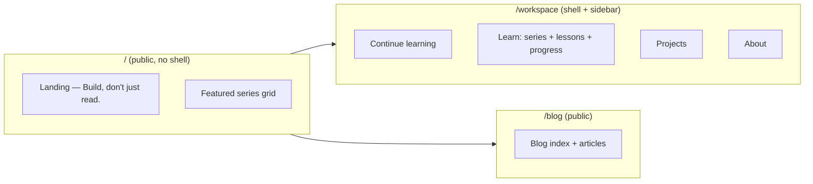

# Shipwalk: Tutorials-First Product Revamp

## Context

The web app grew from a blog into a learning platform. We are rebranding it as **Shipwalk**, a tutorials-first product with a marketing landing page (`/`) and an authenticated dashboard shell (`/workspace`). The blog remains public at `/blog`. This pass restyles the tutorial platform; the blog gets the same treatment in a later phase.

Reference: [sim.ai](https://www.sim.ai) — clean, light, mostly-monochrome SaaS landing.

## Locked Decisions

| Item | Decision |
|---|---|
| Identity | Pure product branding; person (Vantol Bennett) named in footer only |
| Home (`/`) | Marketing landing promoting tutorials: hero "Build, don't just read." + featured series grid |
| Brand name | **Shipwalk** |
| Dashboard | `/workspace` shell with light sidebar; hybrid auth (read public, account for progress/bookmarks) |
| Blog | Public at `/blog`, outside the shell |
| Scope (this pass) | Tutorial platform first (landing, workspace shell, learn pages). Blog + other pages restyled later |
| Routes | Section-prefixed (`/workspace/learn/:series/:step`); build-time unique-slug check across collections |
| Nav (marketing) | Lean top links + `About ▾` / `More ▾` dropdowns |
| Visual | Light-primary (sim.ai), zinc neutrals, **amber accent** (#f5c542); fallback to black if amber misses |
| Theme | Light default + dark mode honored via prefers-color-scheme |
| Workspace home | Progress-first: "Continue learning" with resume cards + progress bars |
| Sidebar | Light (#fafafa) |

## Architecture



### Route map

```
/                              Shipwalk marketing landing (public)
/blog                          Blog index (public)
/blog/:slug                    Blog article (public)
/workspace                     Dashboard home — "Continue learning"
/workspace/learn               Series index (browse all)
/workspace/learn/:series       Series landing
/workspace/learn/:series/:step Lesson page (stepper sidebar, progress)
/workspace/projects            Projects
/workspace/about               About
/workspace/...                 remaining sections move later
```

### Unique naming / platform safety

- All routes are section-prefixed so a slug can never collide across collections.
- A CI/build-time check (or collection schema validation) flags any duplicate slug across `tutorials`, `blog`, `projects`.
- Content collections stay as-is: `blog`, `tutorials` (from learn-layer), `projects`, `about`, `uses`, `gallery`, `explore`, `publications`, `pages`.

## Visual Language

Light-primary neutral system:

| Token | Value |
|---|---|
| bg | `#ffffff` |
| bg-subtle | `#fafafa` |
| ink | `#18181b` |
| muted | `#71717a` |
| border | `#e4e4e7` |
| accent | `#f5c542` (amber) — fallback `#0f172a` (black) |
| sidebar | `#fafafa` |

- CTAs: solid ink (`#0f172a`) buttons with white text; amber reserved for progress bars, active links, highlights.
- Type: tight tracking headlines (letter-spacing -0.02em), zinc-scale body.
- Dark mode: mirrored zinc values on near-black (`#0c0c0c`) bg.

## Component / Page Inventory (this pass)

1. **Marketing shell + nav** — sticky header, Shipwalk wordmark, lean links + dropdowns, "Workspace" CTA. Footer with person credit.
2. **Landing page (`/`)** — hero ("Build, don't just read."), subcopy, two CTAs, featured series grid (computed from `tutorials` collection), footer.
3. **Workspace shell** — light sidebar (Learn: Home/My Courses/Browse All; Content: Projects/About/Publications/Gallery; Account: Settings/Sign out) + content pane.
4. **Workspace home** — "Continue learning": resume cards with amber progress bars from `useTutorialProgress`.
5. **Learn pages** — series index, series landing, lesson page (existing stepper/progress logic restyled light).
6. **Auth wiring** — hybrid: content readable without session; progress persistence + bookmarks require sign-in; `middleware` or route guard on interactive actions only.

## Data Flow

- `queryCollection("tutorials")` powers landing featured grid + workspace learn pages.
- `useTutorialProgress` (learn-layer) tracks completion per step; workspace home aggregates per-series progress.
- Auth via existing better-auth client; sidebar shows session state (Sign in / avatar + Sign out).

## Error Handling

- Lesson/series 404 via `createError`.
- Non-authenticated users can read; interactive actions show sign-in prompt rather than hard redirect.
- Slugs flagged by CI check fail the build before deploy.

## Testing

- Unit: unique-slug validator across collections.
- Workspace home progress aggregation.
- Existing `useTutorialProgress` behavior preserved.
- `vp check` + `vp test` gate before commit.
